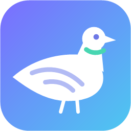
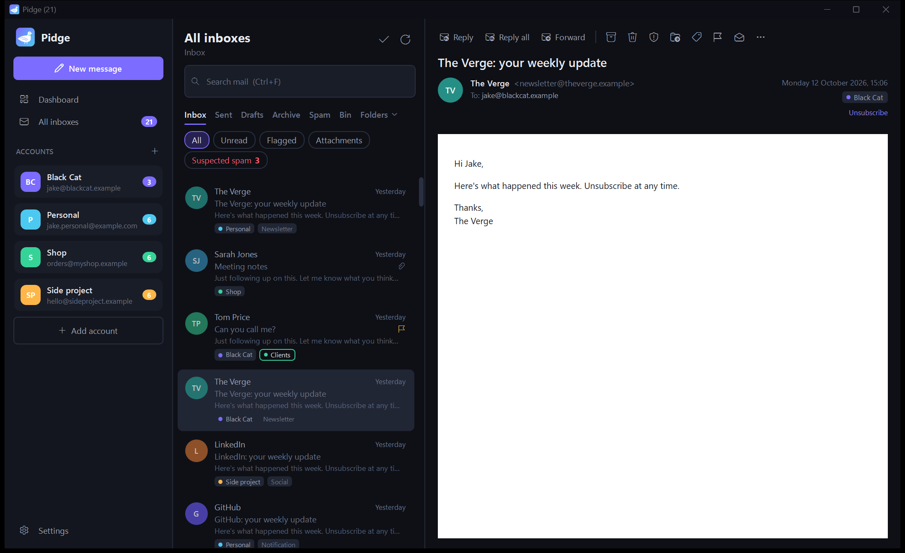
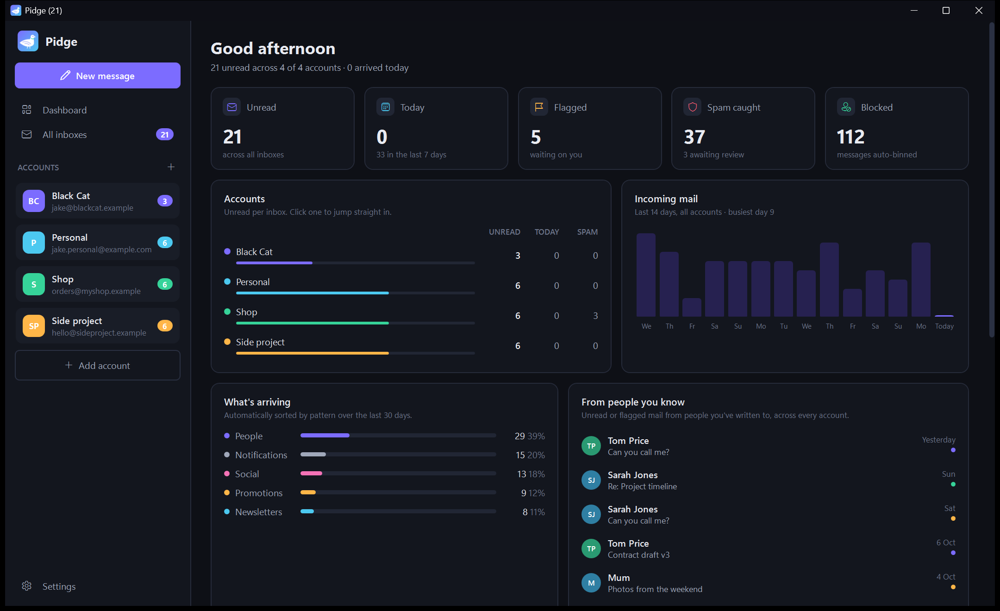
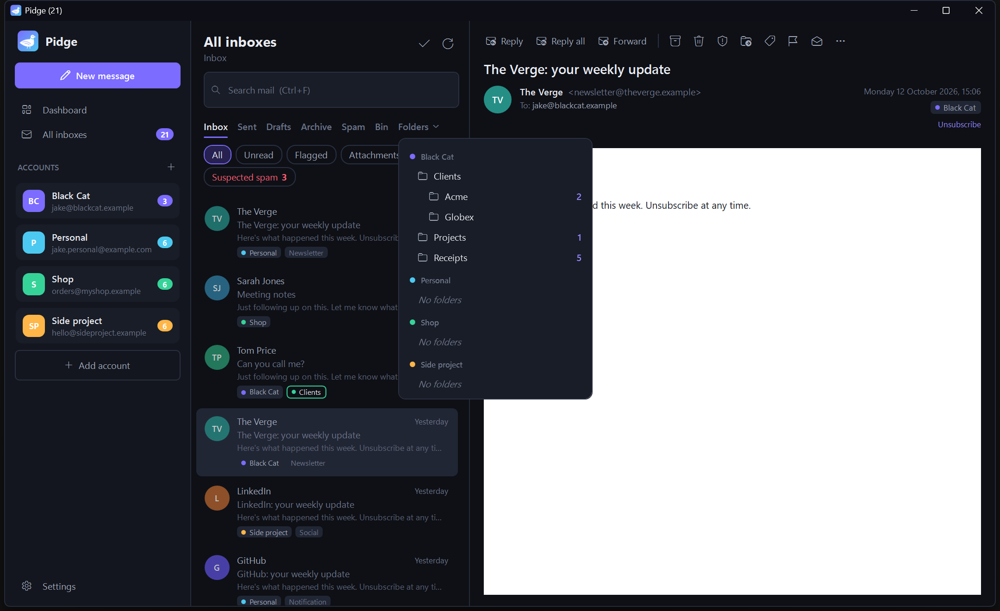
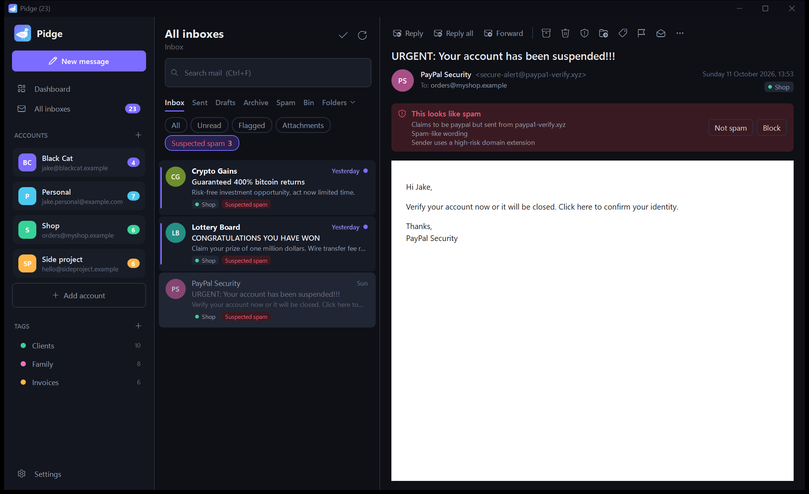
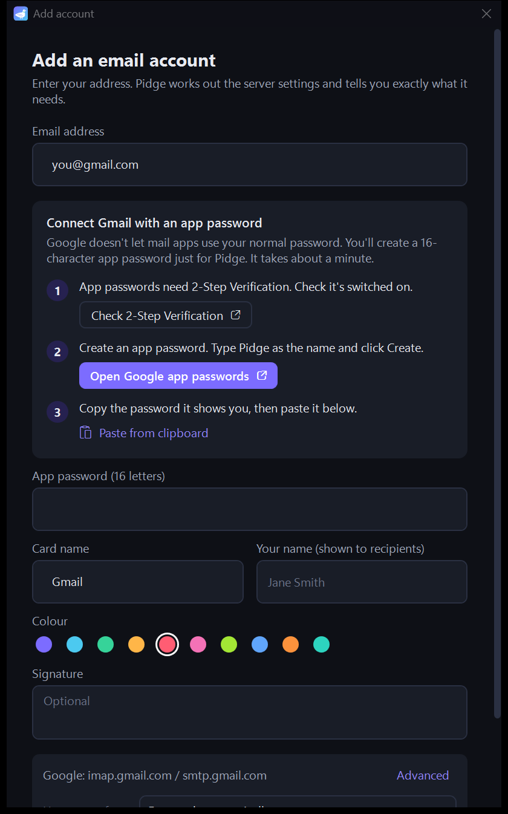
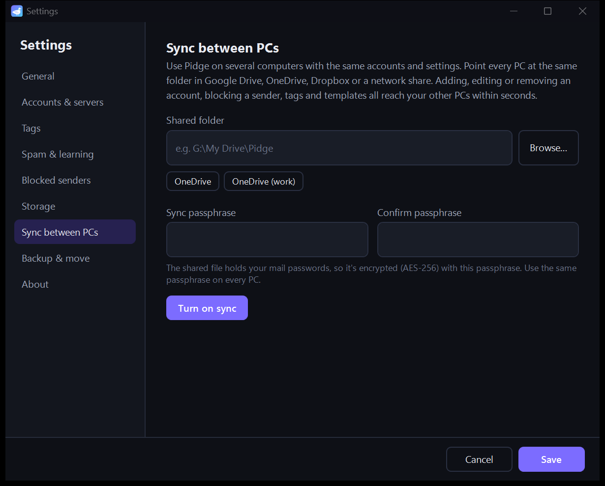
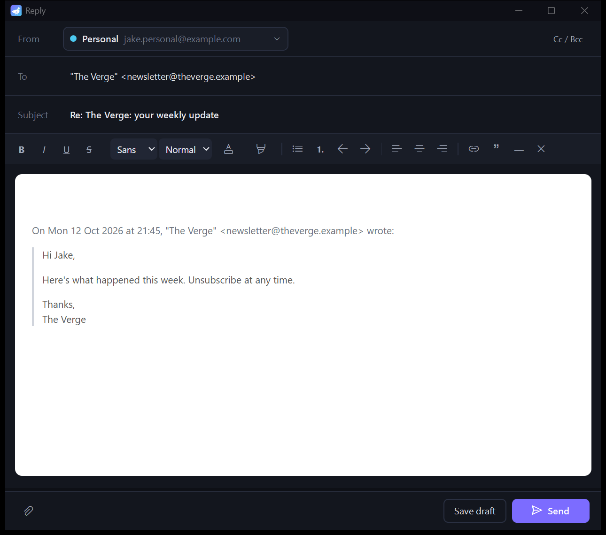
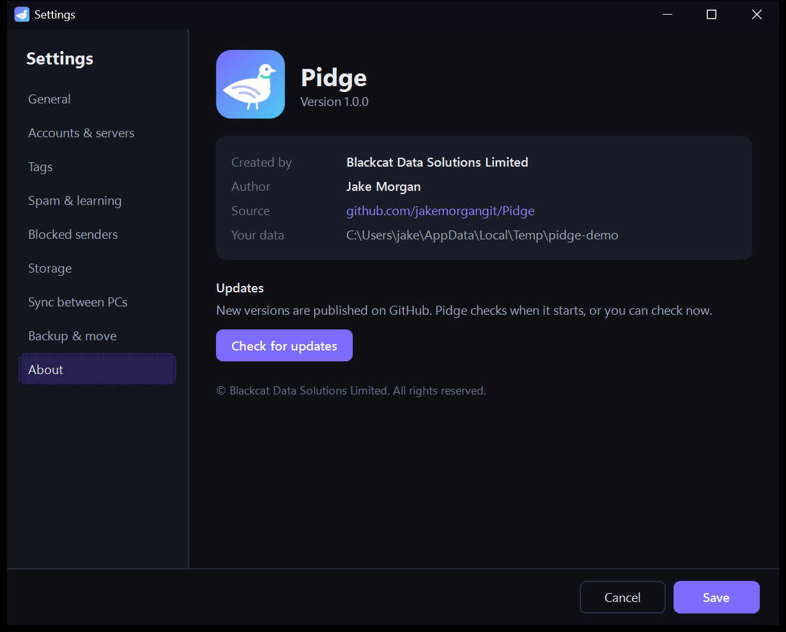

<p align="center">
  
</p>

<h1 align="center">Pidge</h1>

<p align="center">
  Your mail, carried home. A fast, dark-mode email client for Windows, built for people with a lot of email accounts.<br>
  <a href="https://github.com/jakemorgangit/Pidge/releases/latest"><b>Download the latest MSI</b></a>
  · by Blackcat Data Solutions Limited
</p>



## Why Pidge

If you have five, ten or twenty mailboxes, most email apps make you check them one at a time. Pidge puts every account on one calm screen:

- **Account cards**: each account is a small card on the left with its own colour and unread count. Click one to open its inbox.
- **All inboxes**: work through every account as if it were one mailbox. Replies go out from whichever account received the email.
- **Unread mail stands out**: bold, bright and dotted. Read mail steps back.
- **Instant reading**: new mail is downloaded and stored (compressed) on your PC as it arrives, so opening it doesn't wait for the server.
- **Fast, safe triage**: press Delete and the email instantly shows a red bin and spinner while the next one opens. It disappears only when the server confirms, and pressing Delete again never touches an email that's already on its way out. Background syncing uses its own connection, so your actions never queue behind it.
- **Not overwhelming**: the extras (tags, folders, sync) stay out of the way until you use them.

## Dashboard

Press **Ctrl+D** from anywhere for one view of every account:



- Unread, received today, flagged, spam caught and blocked, across every inbox
- Per-account breakdown (click an account to jump straight in)
- Incoming mail over the last 14 days, and what's arriving (people, newsletters, notifications, social, promotions)
- Unread or flagged mail from people you've written to before
- Your tags, top senders, and **suggested clean-up**: senders who email you often but whose messages you never open

## Folders



Inbox, Sent, Drafts, Archive, Spam and Bin cover the everyday folders. **Folders ▾** opens everything else on the server (your own folders and sub-folders), grouped by account in All inboxes. Move mail into a folder with **V** or right-click → *Move to folder…*.

## Tags that learn

Right-click any email → **Tag…** (or press **T**). Pick a tag or create one.

- Tagging a message teaches Pidge the sender: their past and future mail gets the same tag automatically.
- When people from the same organisation share a tag, the whole domain is tagged (never for public providers like gmail.com).
- Untag something and Pidge stops tagging that sender.
- Open tagged mail from the dashboard. Rename, delete, or remove learned rules under right-click → *Manage tags…*.

## Spam detection that learns



Pidge scores every incoming message using:

- your mail server's own spam verdict, plus SPF, DKIM and DMARC sender checks
- **impersonation checks**: "PayPal" sent from `paypa1-verify.xyz`, or a display name that shows a different email address
- **look-alike links**: link text that shows one site but actually goes to another
- high-risk domains, random-looking senders, shouting subjects and spammy wording
- a **Bayesian filter trained by you**: every *Spam* / *Not spam* you press teaches it your patterns

Suspected spam is held for review rather than silently deleted, and each message shows *why* it was flagged. People you've emailed before are never flagged. **Block** a sender or a whole domain and their mail skips the inbox in every account.

## Adding accounts



Type your address. Pidge works out the servers (known providers, your domain's MX records for Google Workspace, Microsoft 365, DreamHost and others, the Thunderbird autoconfig database, then probing) and tells you exactly what it needs:

- **Gmail, Yahoo, iCloud**: a guided, step-by-step app-password setup. It opens the right security pages for you, and you paste the password with one click.
- **Outlook.com, Hotmail, Microsoft 365**: **Sign in with Microsoft** in your browser. Microsoft no longer accepts passwords from mail apps (see [Microsoft sign-in setup](#microsoft-sign-in-setup)).
- **Everyone else** (DreamHost, cPanel hosts, your own server): save the servers once as a **template**, or choose *Same as* one of your existing accounts, so you never type `imap.dreamhost.com` again.

<br clear="right">

## Sync between PCs



Use Pidge on several computers with identical accounts and settings. In **Settings → Sync between PCs**, point each PC at the same folder in Google Drive, OneDrive, Dropbox or a network share (Pidge suggests the ones it finds) and use the same passphrase.

From then on, accounts (added, edited or removed), blocked senders, tags, templates, your address book and spam-filter learning reach your other PCs within seconds. Contacts and spam learning are merged (the higher count wins), so nothing one PC has learned is lost. On a brand-new install, just turn on sync with the same folder and passphrase and everything comes through. The shared file is encrypted with **AES-256-GCM** using your passphrase, because it holds your mail passwords.

<br clear="right">

## Writing email



Formatting (bold, italic, lists, quotes, colours, links), a signature per account, attachments (drag and drop), contact autocomplete, Cc/Bcc and drafts. **Ctrl+Enter** sends.

## Notifications

New mail pops up as a Windows notification with the sender, subject and a preview, plus **Mark as read**, **Archive** and **Delete** buttons. Click it to jump straight to the email.

- They stay quiet while Pidge is in front of you, for suspected spam, and when Windows *Do not disturb* is on.
- The **bell** next to Settings pauses them for an hour, until tomorrow morning, or until you turn them back on.
- Right-click an account card → **Mute notifications** to silence one account. A crossed-out bell shows on its card.
- **Settings → Notifications**: sound on/off, "only for mail from people" (skips newsletters, promotions and automated mail), and per-account choices.

## Company logos and colours

Mail from businesses and organisations shows the company's logo instead of initials, so you can spot your bank, suppliers and services at a glance. Turn on **brand colour tint** and each company's emails get a soft wash of its brand colour.

- Personal addresses (Gmail, Outlook/Hotmail, Yahoo, iCloud, Proton, BT, Sky…) keep their initials.
- Logos come from the company's own website (falling back to DuckDuckGo's icon service). The colour is the site's declared theme colour, or the main colour of its logo. Black-and-white logos get no tint.
- Each company is looked up once and cached for a month, never when you open an email, so it can't act as a read receipt.
- Toggle both under **Settings → General**.

## Comfortable to read

- **Text size**: hold **Ctrl** and turn the mouse wheel anywhere (or **Ctrl +/−**) to zoom the whole app, emails included. There's also a slider in Settings → General.
- **Dark reading mode** for emails that are only designed for white backgrounds.

## Storage

Downloaded emails are stored **compressed** (Brotli, typically a third to a fifth of their original size). **Settings → Storage** shows how much space Pidge uses, can drop downloaded emails you haven't opened for a while (they download again if you open them), and compacts everything. It also tidies up automatically once a day.

## Backup & moving to a new PC

**Settings → Backup & move** exports everything into one password-protected file (AES-256-GCM, key derived with PBKDF2-SHA256, 600,000 iterations). It contains every account including passwords, blocked and trusted senders, tags, templates, contacts, spam learning and settings. Import it anywhere.

## Privacy & security

- Remote images are blocked until you allow them (once, or always for a sender), which stops read-tracking pixels.
- Scripts never run inside emails, and links open in your normal browser, with a warning first if a message looks suspicious.
- Opening risky attachment types (`.exe`, `.js`, `.vbs`…) asks for confirmation.
- Passwords and sign-in tokens are encrypted with Windows DPAPI, tied to your Windows account.
- Everything is stored locally in `%LOCALAPPDATA%\Pidge`. Pidge talks only to your mail servers, plus a one-off DNS/autoconfig lookup when you add an account and the GitHub update check.

## Keyboard shortcuts

| Anywhere | | In the message list | |
|---|---|---|---|
| Ctrl+N | New message | R / A / F | Reply / reply all / forward |
| Ctrl+D | Dashboard | E | Archive |
| Ctrl+0 | All inboxes | V | Move to folder |
| Ctrl+1…9 | Jump to account | T | Tag |
| Ctrl+F | Search | Del | Delete |
| F5 | Check mail | J | Mark as spam |
| Ctrl + / − / wheel | Text size | S / U | Flag / read-unread |

Compose: **Ctrl+Enter** send · **Ctrl+K** insert link · **Ctrl+Shift+S** save draft.

## Install & updates

Download `Pidge-x.y.z-x64.msi` from the [latest release](https://github.com/jakemorgangit/Pidge/releases/latest) and run it.

- Installs for your user only (no admin rights needed) to `%LOCALAPPDATA%\Programs\Pidge`, with Start menu and desktop shortcuts. Includes the .NET runtime.
- Needs the Microsoft Edge WebView2 runtime, which comes with Windows 10 and 11.
- Not code-signed yet, so SmartScreen may ask you to confirm the first time (*More info → Run anyway*).
- **Upgrading from QuickMail** (Pidge's old name): the MSI replaces it, and your accounts and mail move across automatically.

Pidge checks GitHub Releases when it starts. When there's a new version it shows the release notes and offers **Install and restart**.

<p align="center"></p>

## Microsoft sign-in setup

Outlook.com and Microsoft 365 only accept OAuth sign-in from mail apps, which needs a (free) app registration in Microsoft Entra ID. Do this once:

1. Sign in at [entra.microsoft.com](https://entra.microsoft.com) → **Applications → App registrations → New registration**.
2. Name: `Pidge`. Supported account types: **Accounts in any organizational directory and personal Microsoft accounts**.
3. Redirect URI: platform **Public client/native (mobile & desktop)**, value `http://localhost`. Click **Register**.
4. Under **Authentication**, set **Allow public client flows** to **Yes** and save.
5. Under **API permissions → Add a permission → APIs my organization uses → Office 365 Exchange Online → Delegated**, add `IMAP.AccessAsUser.All` and `SMTP.Send`.
6. Copy the **Application (client) ID** from the Overview page and either paste it into **Pidge → Settings → Accounts & servers**, or set `MicrosoftAuth.BuiltInClientId` in `src/Pidge/Services/MicrosoftAuth.cs` so every build has it.

Microsoft 365 work accounts may also need an administrator to allow the app, and SMTP AUTH must be enabled on the mailbox to send.

## Building from source

Requires the [.NET 10 SDK](https://dotnet.microsoft.com/download).

```powershell
dotnet run --project src/Pidge                # run from source
dotnet test tests/Pidge.Tests                 # integration tests (needs Docker for the test IMAP server)
./build.ps1 -Version 1.0.0                    # self-contained publish + artifacts/Pidge-1.0.0-x64.msi
```

The tests start a throwaway [GreenMail](https://greenmail-mail-test.github.io/greenmail/) IMAP/SMTP server in Docker and cover syncing, folders, moving mail, tag learning, the compressed cache, settings sync and the QuickMail → Pidge data migration.

### Releasing

```powershell
git tag v1.1.0
git push origin v1.1.0
```

The **Release** workflow builds the MSI and publishes a GitHub release. Installed copies pick it up on their next start.

### Demo data

To explore the UI without real accounts (this is how the screenshots were made):

```powershell
$env:PIDGE_DATA = "$env:TEMP\pidge-demo"      # use a separate data folder
$env:PIDGE_OFFLINE = "1"                      # never contact mail servers
dotnet run --project src/Pidge                # start once to create the database, then close it
python tools/seed_demo.py "$env:TEMP\pidge-demo"
dotnet run --project src/Pidge
```

## Tech

.NET 10 · WPF · [MailKit](https://github.com/jstedfast/MailKit) (IMAP/SMTP/OAuth) · SQLite + Dapper · WebView2 (mail rendering and the compose editor) · CommunityToolkit.Mvvm · WiX v5

---

© Blackcat Data Solutions Limited · Author: Jake Morgan
