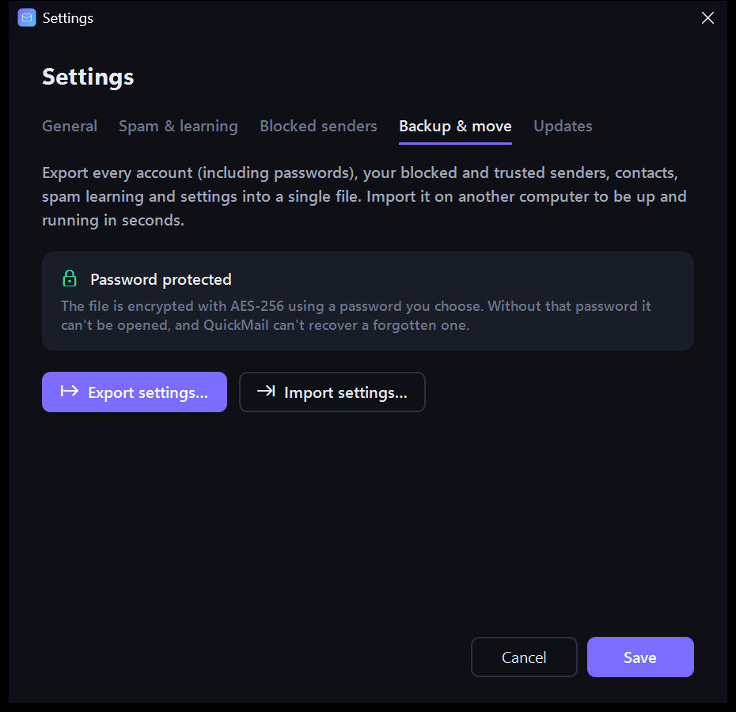

<p align="center">
  
</p>

<h1 align="center">QuickMail</h1>

<p align="center">
  A sleek, dark-mode email client for Windows, built for people who juggle a lot of email accounts.<br>
  <a href="https://github.com/jakemorgangit/QuickMail/releases/latest"><b>Download the latest MSI</b></a>
</p>


## Why QuickMail

If you have five, ten or twenty mailboxes, most email apps make you check them one at a time. QuickMail puts every account on one screen:

- **Account cards**: each account is a small card in the left pane with its own colour and unread count. Click one to open its inbox.
- **All inboxes**: work through every account as if it were one mailbox. Reply, forward, archive, flag and search across all of them. Replies go out from whichever account received the email.
- **Fast triage**: single-key shortcuts, multi-select, and the next message opens automatically after you archive or delete one.

## Dashboard

Press **Ctrl+D** from anywhere for a consolidated view of every account:


- Unread, received today, flagged, spam caught and blocked, across every inbox
- Per-account breakdown (click an account to jump straight in)
- Incoming mail over the last 14 days
- What's arriving: people, newsletters, notifications, social and promotions, sorted automatically
- Unread or flagged mail from people you've written to before
- Top senders, and **suggested clean-up**: senders who email you often but whose messages you almost never open, with one-click block

## Spam detection that learns


QuickMail scores every incoming message using:

- your mail server's own spam verdict, plus SPF, DKIM and DMARC sender checks
- **impersonation checks**: "PayPal" sent from `paypa1-verify.xyz`, or a display name that shows a different email address
- **look-alike links**: link text that shows one site but actually goes to another
- high-risk domains, random-looking senders, shouting subjects and spammy wording
- a **Bayesian filter trained by you**: every *Spam* / *Not spam* you press teaches it your patterns

Suspected spam is held under *Suspected spam* for you to review rather than silently deleted, and each message shows *why* it was flagged. People you've emailed before are never flagged.

**Blocking**: block a sender, or a whole domain, from any message or from the dashboard. Their existing mail is binned, and anything new skips the inbox in every account.

## Writing email


Formatting (bold, italic, lists, quotes, colours, links), a signature per account, attachments (drag and drop), contact autocomplete, Cc/Bcc and drafts. **Ctrl+Enter** sends.

## Adding accounts


Type your address and password. QuickMail works out the server settings for you:

1. Known providers (Gmail, Outlook.com, Yahoo, iCloud, Fastmail, Zoho, GMX, AOL, Yandex, Proton Bridge)
2. Your domain's MX records, so custom domains hosted on Google Workspace or Microsoft 365 just work
3. The Thunderbird autoconfig database and your domain's own autoconfig file
4. Probing common host names

Anything can be overridden under *Advanced*. The connection is tested before the account is saved.

> **Gmail, Yahoo and iCloud** need an *app password* rather than your normal password when two-step sign-in is on. **Outlook.com and some Microsoft 365 accounts** may refuse password sign-in for IMAP altogether. QuickMail shows the relevant hint when you add the account.

<br clear="right">

## Backup & moving to a new PC



**Settings → Backup & move** exports everything into one file: every account *including its password*, your blocked and trusted senders, contacts, what the spam filter has learned, and your settings.

The file is encrypted with **AES-256-GCM** using a password you choose (key derived with PBKDF2-SHA256, 600,000 iterations). Import it on another computer and you're set up in seconds. Without the password the file can't be opened, and a forgotten password can't be recovered.

<br clear="right">

## Privacy & security

- Remote images are blocked until you allow them (once, or always for a sender), which stops read-tracking pixels.
- Scripts never run inside emails, and links open in your normal browser. You get a warning first if a message looks suspicious.
- Opening risky attachment types (`.exe`, `.js`, `.vbs`…) asks for confirmation.
- Passwords are encrypted with Windows DPAPI, tied to your Windows account.
- Mail is cached locally in `%LOCALAPPDATA%\QuickMail`. Nothing goes anywhere except your own mail servers, plus a one-off DNS/autoconfig lookup of your domain when you add an account and the GitHub update check.

## Keyboard shortcuts

| Anywhere | | In the message list | |
|---|---|---|---|
| Ctrl+N | New message | R / A / F | Reply / reply all / forward |
| Ctrl+D | Dashboard | E | Archive |
| Ctrl+0 | All inboxes | Del | Delete |
| Ctrl+1…9 | Jump to account | J | Mark as spam |
| Ctrl+F | Search | S | Flag |
| F5 | Check mail | U | Read / unread |

Compose: **Ctrl+Enter** send · **Ctrl+K** insert link · **Ctrl+Shift+S** save draft.

## Install

Download `QuickMail-x.y.z-x64.msi` from the [latest release](https://github.com/jakemorgangit/QuickMail/releases/latest) and run it.

- Installs for your user only (no admin rights needed) to `%LOCALAPPDATA%\Programs\QuickMail`, with Start menu and desktop shortcuts.
- Includes the .NET runtime. It also needs the Microsoft Edge WebView2 runtime, which comes with Windows 10 and 11.
- The MSI isn't code-signed yet, so Windows SmartScreen may ask you to confirm on first run (*More info → Run anyway*).

### Updates

QuickMail checks GitHub Releases each time it starts. When a newer version exists it shows the release notes and offers **Install and restart**, which downloads the MSI, upgrades in place and reopens. You can also check from **Settings → Updates**, or skip a version.

## Building from source

Requires the [.NET 10 SDK](https://dotnet.microsoft.com/download).

```powershell
dotnet run --project src/QuickMail            # run from source
./build.ps1 -Version 1.0.0                    # self-contained publish + artifacts/QuickMail-1.0.0-x64.msi
```

The MSI is built with the WiX Toolset v5 SDK, restored automatically from NuGet.

### Releasing

```powershell
git tag v1.1.0
git push origin v1.1.0
```

The **Release** workflow builds the MSI and publishes a GitHub release. Installed copies pick it up on their next start.

### Trying it with demo data

To explore the UI without real accounts (this is how the screenshots were made):

```powershell
$env:QUICKMAIL_DATA = "$env:TEMP\qm-demo"     # use a separate data folder
$env:QUICKMAIL_OFFLINE = "1"                  # never contact mail servers
dotnet run --project src/QuickMail            # start once to create the database, then close it
python tools/seed_demo.py "$env:TEMP\qm-demo" # add fake accounts and mail
dotnet run --project src/QuickMail
```

## Tech

.NET 10 · WPF · [MailKit](https://github.com/jstedfast/MailKit) (IMAP/SMTP) · SQLite + Dapper · WebView2 (mail rendering and the compose editor) · CommunityToolkit.Mvvm · WiX v5
